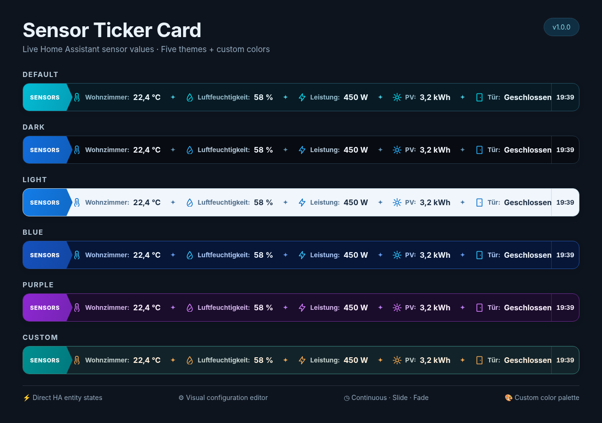

# Sensor Ticker Card – Deutsche Anleitung

**Sensor Ticker v1.0.1** ist eine eigenständige Dashboard-Karte, die Home-Assistant-Entitäten als animierte Laufschrift darstellt. **Keine RSS-Feeds, kein Backend, keine weitere HA-Integration.**



*Illustration mit fiktiven Sensorwerten; tatsächliche Optik kann je nach Home-Assistant-Theme leicht abweichen.*

### Animationsvorschau


## Funktionen

- Bis zu 30 Entitäten auswählen, aktivieren, sortieren und umbenennen
- Werte und Einheiten **direkt aus Home Assistant** (`state`, `unit_of_measurement`)
- Icons über Dropdown mit Vorschau, eigene `mdi:`-Icons weiterhin möglich
- Drei Animationen: Endloslauf, Ein-/Ausfahren, Überblenden
- Sechs Designoptionen: Default, Dark, Light, Blue, Purple und Custom (acht frei einstellbare Farben sowie optionale Transparenz)
- Höhe, Schrift, Geschwindigkeit, Nachkommastellen und Uhr einstellbar
- Klick auf einen Eintrag öffnet die Entitätsdetails
- Werte ändern sich live, ohne die Animation neu zu starten
- Keine unnötige Attributauswahl oder manuelle Einheitenüberschreibung

## Installation über HACS

**Sensor Ticker Card ist im offiziellen HACS-Katalog aufgenommen.** Für die normale Installation musst du kein benutzerdefiniertes Repository mehr hinzufügen.

1. **HACS** in Home Assistant öffnen.
2. Nach **Sensor Ticker Card** suchen und den Eintrag unter **Dashboard** öffnen.
3. **Herunterladen** beziehungsweise **Installieren** auswählen und die aktuelle Version installieren.
4. Browser neu laden, Dashboard bearbeiten und die **Sensor Ticker Card** über die Kartenauswahl hinzufügen.

HACS trägt die JavaScript-Ressource normalerweise automatisch ein. Wenn du deine Dashboard-Ressourcen manuell per YAML verwaltest, kann dieser Eintrag nötig sein:

```yaml
url: /hacsfiles/ha-sensor-ticker/sensor-ticker-card.js
type: module
```

### Alternative: Benutzerdefiniertes HACS-Repository

Falls die **Sensor Ticker Card** noch nicht in der HACS-Suche erscheint, unter **HACS → Benutzerdefinierte Repositories** die Adresse `https://github.com/HomeAssi82VK/ha-sensor-ticker` als Kategorie **Dashboard** (auch **Plugin** genannt) hinzufügen und von dort installieren.

**Kein Home-Assistant-Core-Neustart und keine zusätzliche Integration unter Geräte & Dienste nötig.**

## Manuell installieren (ohne HACS)

1. ZIP entpacken, `dist/sensor-ticker-card.js` nach `/config/www/sensor-ticker-card.js` kopieren.
2. Unter **Einstellungen → Dashboards → Ressourcen** als JavaScript-Modul hinzufügen:

   `/local/sensor-ticker-card.js?v=1.0.1`

3. Browser mit **Strg + F5** aktualisieren, Dashboard bearbeiten, Sensor Ticker Card auswählen.

**Wechsel zur HACS-Installation:** Alten `/local/…`-Ressourceneintrag erst entfernen, wenn HACS die neue Ressource eingerichtet hat. Nicht beide Versionen gleichzeitig laden.

## Anzeige

Die Karte zeigt den echten Zustand jeder Entität und übernimmt Maßeinheiten automatisch aus Home Assistant. Nachkommastellen formatieren nur Zahlen; sie rechnen keine Einheiten um. Für Thermostat-Temperaturen einen separaten Temperatursensor auswählen, falls der normale Zustand eines `climate.*`-Objekts kein Temperaturwert ist.

Beispiel: [`examples/card.yaml`](examples/card.yaml). Fehler und Vorschläge: [GitHub Issues](https://github.com/HomeAssi82VK/ha-sensor-ticker/issues).

## Projekt unterstützen ☕

[](https://buymeacoffee.com/homeassi82vk)

[MIT-Lizenz](LICENSE) · HomeAssi82VK · Community-Projekt, nicht offiziell von Home Assistant

## Wechsel von Version 0.x

Bestehende Kartenkonfigurationen bleiben erhalten. Die früheren Themes werden automatisch zugeordnet: `nightglow` → Default, `minimal` → Dark, `tv` → Blue, `transparent` → Custom mit transparentem Hintergrund. Die alten Attribute- und Einheiteneinstellungen werden weiterhin ignoriert.

